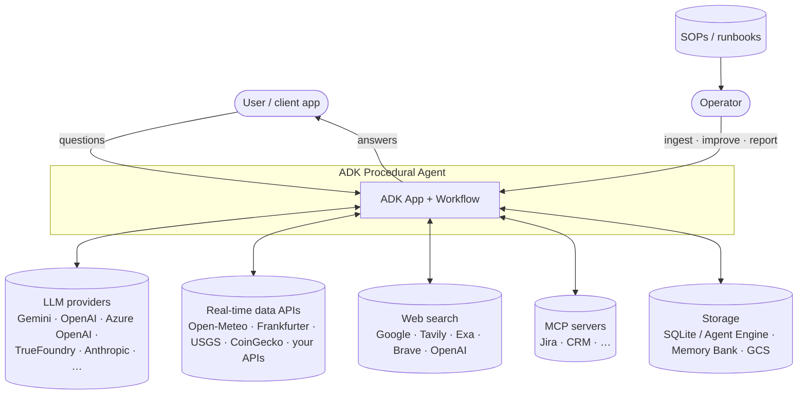
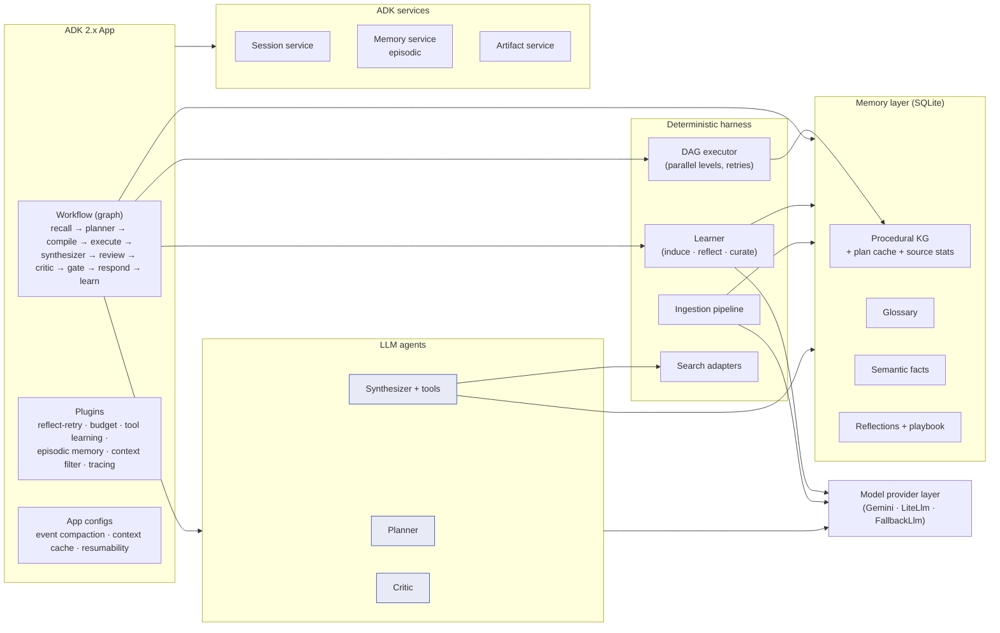

# High-level design

## 1. Purpose and scope

The agent answers questions that need **live data from several sources**, such as weather, FX
rates, air quality, hazards and prices. It does this through **procedures**: reusable recipes kept
in a knowledge graph, which may depend on each other. It must:

- turn one question into the right set of procedures, whether one or many, dependent or independent
- fetch data fast (in parallel where possible) and reliably (retries, fallbacks, honest gaps)
- check its own answers before replying
- remember users, facts, vocabulary and past episodes
- **learn** new procedures and strategies from its own runs, and **improve** its prompts offline
- run on any major LLM provider

## 2. System context



## 3. Component view



| Component | Responsibility | Code |
|---|---|---|
| Workflow | Orders the nodes, routes revise/replan loops, carries state | `agent.py`, `harness/nodes.py` |
| Planner / Synthesizer / Critic | LLM roles: plan, answer with tools, verify | `agent.py`, `prompts/*.md` |
| DAG executor | Runs compiled plans level by level, in parallel | `harness/executor.py` |
| Procedural KG | Procedures, dependencies, sources, stats, plan cache, compile | `memory/procedural_kg.py` |
| Skill registry | Exposes the KG as ADK Skills | `memory/skill_registry.py` |
| Glossary | Canonical names, values and concepts | `memory/glossary.py` |
| Semantic / reflective memory | Facts and preferences; lessons and playbook | `memory/semantic.py`, `memory/reflection.py` |
| Learner | Induces procedures, writes lessons, curates the playbook | `harness/learner.py`, `nodes.learn` |
| Ingestion | Text → staged graph changes → apply | `harness/ingest.py`, `scripts/ingest.py` |
| Provider layer | Model specs → models; reasoning and caching parameters | `llm.py` |
| Plugins | Cross-cutting: retries, budget, learning, memory, tracing | `harness/plugins.py` |
| Offline improvement | Consolidation, reports, GEPA prompt optimisation | `scripts/improve.py`, `prompts/__init__.py` |

## 4. Deployment views

=== "Local / single node"

    ```mermaid
    flowchart LR
      CLI[run_cli.py / adk web] --> App[ADK App]
      App --> S1[(sessions.sqlite)]
      App --> S2[(episodic_memory.sqlite)]
      App --> S3[(agent_memory.sqlite<br/>KG · glossary · facts · reflections)]
      App --> F[(.data/artifacts)]
      App --> P[(.data/prompts vN)]
    ```

    Everything lives in `AGENT_DATA_DIR`. One process; ideal for development and single-team use.

=== "Production (Google Cloud)"

    ```mermaid
    flowchart LR
      Client --> CR[Cloud Run / Agent Engine<br/>ADK App]
      CR --> AE[(Agent Engine sessions)]
      CR --> MB[(Vertex AI Memory Bank)]
      CR --> GCS[(GCS artifacts)]
      CR --> VOL[(Persistent volume or Postgres<br/>KG · glossary · facts · reflections)]
      CR --> GW[LLM gateway<br/>TrueFoundry / Vertex]
      Sched[Cloud Scheduler] --> Job[improve.py consolidate / optimize]
      Job --> VOL
    ```

    `MEMORY_BACKEND=vertex` switches sessions, episodic memory and artifacts. The agent's own
    stores need a shared, persistent location. See [Deployment](../operations/deployment.md).

## 5. Key design decisions

| Decision | Why | Trade-off |
|---|---|---|
| **Procedures as a graph**, not prompt text | Dependencies, reuse, stats and learning become data the code can reason about | Needs curation; solved by ingestion review and consolidation |
| **LLM plans, code executes** | Executable procedures run deterministically: fast, cheap, testable, parallel | Steps with no call spec fall back to the LLM with tools |
| **Compiler adds dependencies** | The planner only states needs; closure, composite expansion and ordering are guaranteed | The planner can't override graph edges (by design) |
| **Critic gate with bounded loops** | Catches missing units, hallucinated numbers and missing data before the user sees them | Extra model calls (bounded by `MAX_REVISIONS`, `MAX_REPLANS` and the budget) |
| **Learn online, improve offline** | Cheap, safe updates per turn; expensive prompt optimisation runs on a schedule with a validation gate | New prompts need an eval set |
| **Candidate → active lifecycle** | Learned or ingested knowledge must prove itself before it's fully trusted | Slower adoption of good new procedures |
| **Static/dynamic prompt split** | A stable prefix enables provider prompt caching, while learned context still changes every call | Prompts must keep the `<!-- dynamic -->` marker |
| **SQLite first** | Zero-ops, FTS5 search, portable, testable | Multi-replica deployments need a shared database |
| **Provider layer over LiteLLM** | One spec string per role, fallback chains, any vendor | Some features differ by provider (see the matrix in [Reasoning](../capabilities/reasoning.md)) |

## 6. Quality attributes

| Attribute | How it's met |
|---|---|
| Latency | Parallel levels, plan cache, executable procedures, prompt caching |
| Reliability | HTTP retries with backoff, model fallback chains, `ReflectAndRetry` plugins, skipped-step semantics, source reliability learning |
| Correctness | Critic gate, grounding rules in prompts, structured `Plan`/`Verdict` outputs |
| Safety | HTTP allowlist, safe expression evaluator, LLM budget, staged ingestion with approval, optional tool-call HMAC |
| Cost | Prompt caching, cheap critic/learner models per role, deterministic execution |
| Evolvability | Learned procedures, playbook, versioned prompts with rollback, consolidation |
| Testability | 31 offline tests; the docs' examples are generated by running the real code |
