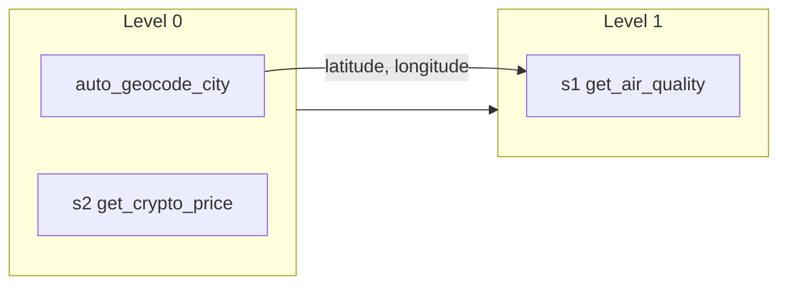

# LLD: DAG executor

`harness/executor.py` runs a compiled plan. It is deterministic Python: no LLM calls.

## Execution model



```python
for level in compiled["levels"]:
    outs = await asyncio.gather(*(guarded(step) for step in level))   # bounded by MAX_PARALLEL_STEPS
    for o in outs:
        results[o["id"]] = o
        kg.record_outcome(o["procedure"], o["ok"], o["latency_ms"])      # ok / failed only
        kg.record_source_outcome(o["source"], o["ok"], o["latency_ms"])
```

Latency is the sum over levels of the slowest step in each level, not the sum of all steps.

## Step result

```json
{"id": "s1", "procedure": "get_air_quality", "ok": true, "status": "ok",
 "outputs": {"us_aqi": 212, "pm2_5": 141.3, "pm10": 238.0},
 "error": null, "source": "open_meteo_air", "latency_ms": 212.4}
```

| `status` | When | Counted in stats? |
|---|---|---|
| `ok` | The call succeeded and every `required` output is present | yes (success) |
| `failed` | HTTP error after retries, missing input, empty required output, bad expression | yes (failure) |
| `skipped` | A step it depends on did not succeed | no |
| `deferred` | `adhoc`, or a procedure with written steps but no call spec; the synthesizer handles it | at turn end, by the outcome |
| `pending_approval` | A `write`/`destructive` step: the rendered call is parked under an approval code | when executed after approval |

## Input binding

For each step, the variables are:

1. the planner's literal inputs (glossary-normalised, then type-coerced: `"250"` → `250`)
2. for each dependency step: if the `DEPENDS_ON` edge has a mapping, `my_input ← their_output`;
   otherwise every output of that step whose name is not already set

## Call kinds

=== "http_json"

    ```json
    {"kind": "http_json", "source": "frankfurter",
     "url": "https://api.frankfurter.app/latest",
     "params": {"from": "{from_currency}", "to": "{to_currency}"},
     "extract": {"rate": "rates.{to_currency}", "date": "date"},
     "required": ["rate"]}
    ```

    - `{var}` templates are filled from the step's variables. A template that is exactly `"{x}"`
      keeps `x`'s type; a missing variable fails the step with `Missing input 'x'`.
    - The host must be in `HTTP_ALLOWLIST`.
    - Retries: up to 2 more attempts on 429/5xx and transport errors, with exponential backoff
      (0.5 s, 1 s). Timeout `STEP_TIMEOUT_S` per request, 3× for the whole step.

=== "compute"

    ```json
    {"kind": "compute", "expr": "round(amount * rate, 2)", "output": "converted"}
    ```

    A **safe evaluator** (an AST whitelist) allows numbers, variables, `+ - * / % **`, unary minus,
    and `round min max abs float`. Anything else, such as attribute access, imports or calls to
    other functions, is rejected.

=== "mcp_tool"

    ```json
    {"kind": "mcp_tool", "server": "techintel", "tool": "get_concept",
     "args": {"slug": "{slug}"}, "extract": {"concept": "."}, "required": ["concept"]}
    ```

    Called through a pooled ADK `MCPSessionManager` session per server (stdio or streamable
    HTTP). The result is structured content if present, else JSON-parsed text. A tool error fails
    the step. Recorded as source `mcp:<server>`.

=== "llm"

    ```json
    {"kind": "llm", "prompt": "Summarise {rising} and {concept} ...", "output": "brief_md"}
    ```

    `{var}` takes inputs and dependency outputs (dicts and lists as compact JSON); `{upstream}`
    is all dependency outputs. Runs on `LLM_STEP_MODEL` via `llm.complete_text` (any provider,
    with fallback).

=== "composite"

    ```json
    {"kind": "composite"}
    ```

    Merges the outputs of all its dependency steps (its expanded parts).

## Path language (`extract`)

| Path | Selects |
|---|---|
| `date` | top-level key |
| `results.0.latitude` | first list element, then a key |
| `rates.{to_currency}` | a templated key (`rates.INR`) |
| `features[*].properties` | maps over a list → a list of each element's `properties` |
| `daily.uv_index_max.0` | first value of a daily series |

Lookups try the key as written, then lower-case, then upper-case. A missing path gives `None`, and
`required` turns that into a failure with a clear message.

## Prompt hygiene and artifact memory

`compact()` trims results before they reach a prompt: lists to 5 items, strings to 400
characters. The full payload of every plan is saved as the session artifact `plan_results.json`,
and `http_get_json` saves payloads over 4 KB as their own artifacts.
