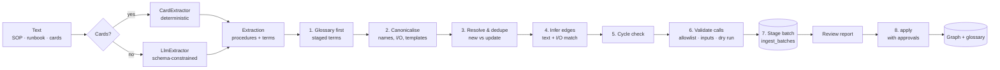

# LLD: Ingestion pipeline

`harness/ingest.py` turns natural-language documents into graph changes. **Nothing touches the
graph until `apply()`.**



## Extraction schema

```python
DraftProcedure(name, description, domain, inputs, outputs, steps_md,
               call=DraftCall(url, params[KV], extract[KV], required, expr),
               depends_on=[DraftDependency(target, relation="needs"|"made_of", mapping[KV])],
               sample_inputs[KV], evidence)
DraftTerm(term, kind="parameter"|"value"|"concept", definition, aliases, applies_to, related_procedures)
```

The LLM extractor gets the names of known procedures and parameters so it can reuse them. It is
told never to invent endpoints and to quote evidence.

## Stage details

| Stage | Logic |
|---|---|
| **Glossary first** | Parameter terms in the batch become aliases right away (`lat_deg → latitude`), so step 2 can use them |
| **Canonicalise** | `safe_name()` for procedure names; `canonical_param()` for I/O; `{lat_deg}` → `{latitude}` inside URLs, params, extract paths and expressions |
| **Resolve & dedupe** | Same name → *update*. Otherwise a candidate with description similarity ≥ 0.25 and `0.5·desc + 0.5·io ≥ 0.65` → *update* that procedure. Otherwise *new* |
| **Resolve a dependency phrase** | Exact name → that one. Otherwise the best of the batch plus the top 3 KG search hits, scoring `jaccard(expanded phrase, name + description) + 0.5 if the candidate produces an input the source needs`; accepted at ≥ 0.3 |
| **Infer edges** | Text-stated → **confirmed**. Input matches another procedure's output (composites excluded; inputs already wired by the text skipped) → **review**. Both → confirmed with signals `["text","io"]` |
| **Cycle check** | Confirmed edges are placed first, against the existing graph; an edge that would close a loop → **rejected** |
| **Validate calls** | Placeholders must be declared inputs → else *invalid*; host must be allow-listed → else *blocked*; with `Sample:` values, call the live API once → *verified* or *failed* (call dropped, procedure kept as steps); without samples → *untested* |
| **Stage** | Saves the report as an `ingest_batches` row (`staged`) and, from the CLI, as `.data/ingest/<id>.json` |
| **Apply** | Upserts terms (origin `ingested`), procedures (new ones as `candidate`; updates keep their status), sources and `USES_SOURCE` edges, confirmed edges, and approved review edges. Marks the batch `applied`; re-applying raises an error |

## Review report format

```text
  [new] get_uv_index  in=['latitude', 'longitude'] out=['uv_index_max']  call: verified
        renamed via glossary: {'lat_deg': 'latitude', 'lng': 'longitude'}
  ✓ get_uv_index -DEPENDS_ON-> geocode_city {...}  (stated in text and inputs match outputs)
  ? travel_budget_in_inr -DEPENDS_ON-> get_fx_rate {'rate': 'rate'}  (inputs ['rate'] match outputs of get_fx_rate; confirm)
  ✗ geocode_city -DEPENDS_ON-> get_weather_forecast  (would create a cycle)
```

`✓` confirmed · `?` needs your approval · `✗` rejected. The full real output is in
[Example 9](../examples/ingestion.md).
