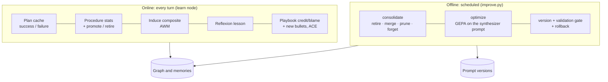
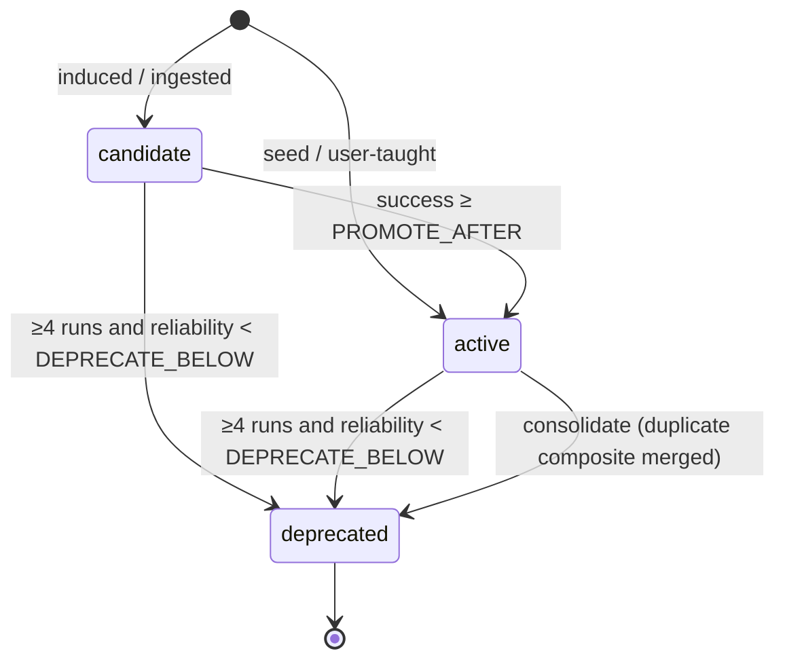
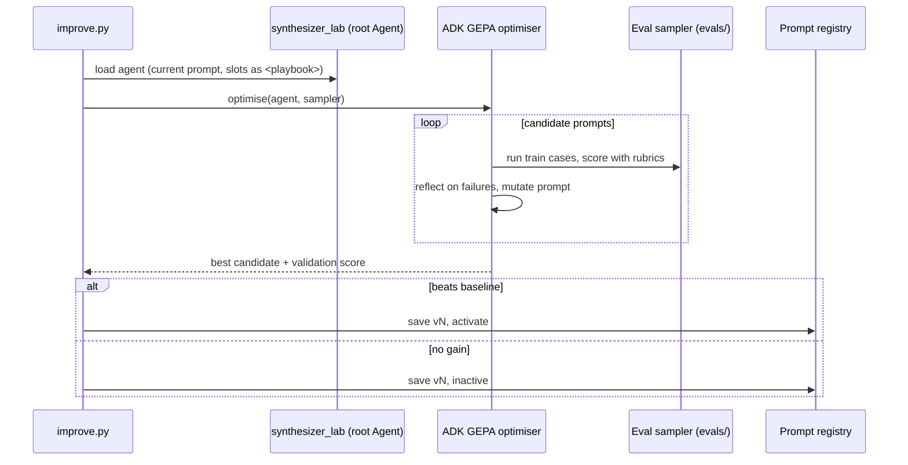

# LLD: Learning & improvement

Learning happens in two loops:

- **Online**, in the `learn` node after every answer: cheap, incremental, and gated by evidence.
- **Offline**, through `scripts/improve.py` on a schedule: memory maintenance and prompt
  optimisation, gated by a validation score.

## The `learn` node, step by step

Inputs: the question, `temp:compiled`, `temp:results`, `temp:verdicts`, `temp:playbook_ids`.
`success` means the last verdict was ok or scored at least `ACCEPT_SCORE`; `first_try` means it
succeeded with a single verdict.

| # | Step | Rule | Evidence |
|---|---|---|---|
| 1 | **Plan cache** | `cache_plan(query, plan, success)` | every turn with steps |
| 2 | **Score deferred steps** | A procedure that ran as written steps (no call spec) gets `record_outcome(success)` | the turn's outcome |
| 3 | **Promote / retire** | Non-seed procedures used this turn: `candidate → active` at `success ≥ PROMOTE_AFTER`; `→ deprecated` at 4+ runs with reliability `< DEPRECATE_BELOW` | accumulated stats |
| 4 | **Induce** (Agent Workflow Memory) | When the turn succeeded, ≥ 2 distinct root procedures were used, **every one of them ran ok**, and no composite with the same parts exists: create a `candidate` composite with `COMPOSED_OF` edges | this run |
| 5 | **Reflect** (Reflexion) | When the first draft did not pass: write one lesson from the verdicts, step errors and final draft | critic issues |
| 6 | **Playbook** (ACE) | The bullets that were in context get `helpful` on a first-try success and `harmful` otherwise; on non-first-try turns, the distiller proposes up to 2 new bullets | outcome |

Learning never breaks a turn: everything is wrapped, and failures are logged. The result is stored
in `last_learning`, for example `{"induced": "weather_air_quality_currency_flow"}`,
`{"promoted": …}` or `{"lesson": 3}`.

## Distillers (`harness/learner.py`)

| Method | `LlmDistiller` (default, `LEARNER_MODE=llm`) | `HeuristicDistiller` (fallback and tests) |
|---|---|---|
| `induce_procedure` | Generalises the run into `InducedProcedure` (name, description, domain, inputs, outputs, steps), with no user-specific literals | `<intent>_flow` with steps "Run `p`…" |
| `reflect` | One actionable `Lesson` with a scope | A source-failure lesson, or the first critic issue |
| `curate` | ≤ 2 new playbook bullets, deduplicated against the current playbook | none |

The LLM distiller calls `llm.complete_json`, so it works on any provider and falls back to the
heuristic version on any error.

## Procedure lifecycle

Candidates are searchable and usable from the start. The status mainly affects ranking and
confidence, and lets operators audit what the agent added.

## Offline: `improve.py consolidate`

| Action | Rule |
|---|---|
| Retire | Reliability `< DEPRECATE_BELOW` after ≥ 4 runs |
| Promote | Candidates at `success ≥ PROMOTE_AFTER` |
| Merge | Learned composites with identical parts: keep the most reliable, deprecate the rest |
| Prune playbook | Deactivate bullets with `helpful − harmful ≤ −2` |
| Forget lessons | Never retrieved and older than 60 days |
| Drop plans | Cached plans with `failures > successes + 1` |

## Offline: `improve.py optimize` (GEPA)

The production root is a `Workflow`, while GEPA tunes a single `Agent`'s instruction. So
`synthesizer_lab/` exposes the synthesizer alone, with the same tools and the full prompt.
Rubrics (`evals/test_config.json`) score whether answers are grounded, complete, dated and honest.
Use `python scripts/improve.py rollback synthesizer 0` to return to the shipped default.
