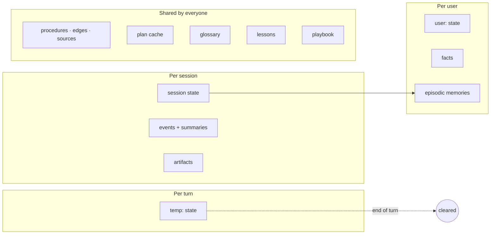
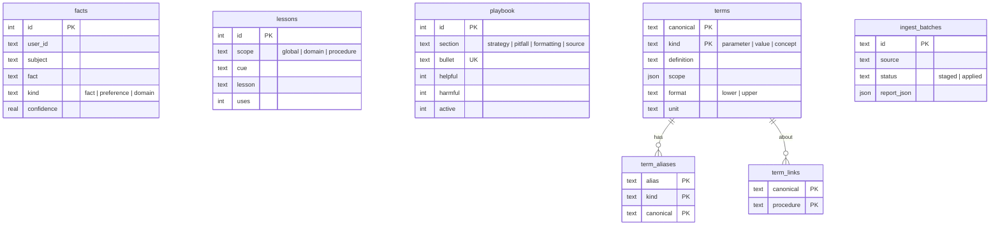

# LLD: Memory stores

## Inventory

| Memory | Store | Written by | Read by | Scope |
|---|---|---|---|---|
| Working | session state, `temp:` keys | every node | every node | one turn |
| Session | session state (`turns`, `plan`, `draft`, `verdict`, `last_learning`) | nodes, output keys | nodes, UI | one session |
| User profile | state, `user:` keys (`user:preferences`) | `remember_fact` | synthesizer prompt | all sessions of a user |
| Summarised history | session events (ADK compaction) | `LlmEventSummarizer` | ADK | one session |
| Episodic | ADK memory service (`SqliteMemoryService` / Memory Bank) | `EpisodicMemoryPlugin` | `recall`, `load_memory` tool | a user, long-term |
| Semantic | `facts` table (+ FTS5) | `remember_fact` | `recall`, `recall_facts` | a user, long-term |
| Procedural | `procedures`, `edges`, `sources` | seed, `learn`, ingestion, `teach_procedure` | `recall`, compile, executor, skills | global |
| Plan cache | `plan_cache` | `learn` | `recall` | global |
| Glossary | `terms`, `term_aliases`, `term_links` | seed, `define_term`, ingestion | `recall`, compile, search, ingestion | global |
| Reflective | `lessons` (+ FTS5) | `learn` | `recall`, skill resources | global |
| Strategic | `playbook` | seed, `learn`, consolidation | dynamic instructions | global |
| Artifacts | artifact service | `execute_plan`, `http_get_json` | user, tools | a session |
| Source reliability | `sources` (incl. `tool:*`) | executor, `ToolLearningPlugin` | ranking, `improve.py report` | global |



## Agent memory database (`agent_memory.sqlite`)



The procedure graph tables are on the [procedural graph page](lld-procedural-graph.md). The FTS5
virtual tables (`procedures_fts`, `facts_fts`, `lessons_fts`) mirror the searchable text.

## Write rules that keep memory clean

| Store | Rule |
|---|---|
| facts | A new fact on the same subject and kind with Jaccard ≥ 0.6 **replaces** the old one |
| lessons | Near-duplicates (Jaccard ≥ 0.7 in the same scope) are not added again |
| playbook | Near-duplicates are skipped; bullets with `helpful − harmful ≤ −2` are deactivated by `prune()` |
| glossary | `define()` merges: it keeps the existing definition unless a new one is given, and unions scopes and aliases |
| procedures | `upsert` bumps `version`; `add_edge` rejects cycles |

## Services (`memory/services.py`)

```python
build_services() -> (session_service, memory_service, artifact_service)
```

| `MEMORY_BACKEND` | Sessions | Episodic memory | Artifacts |
|---|---|---|---|
| `sqlite` | `SqliteSessionService(.data/sessions.sqlite)` | `SqliteMemoryService(.data/episodic_memory.sqlite)` | `FileArtifactService(.data/artifacts)` |
| `vertex` | `VertexAiSessionService` | `VertexAiMemoryBankService` (LLM extraction + consolidation) | `GcsArtifactService` |

`agent_memory()` is a process-wide singleton holding the SQLite store, the KG, facts, reflections
and glossary.
