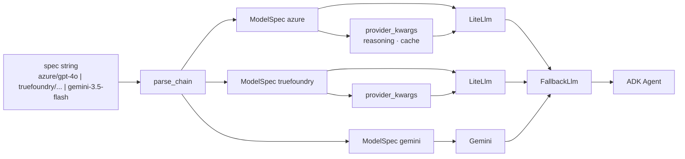

# LLD: Model provider layer

`procedural_agent/llm.py` is the only place that knows about providers. Everything else passes a
**spec string**.



## Spec grammar

```text
chain    := spec ( "|" spec )*
spec     := gemini | provider "/" model
gemini   := "gemini-" … | "gemini/" … | "projects/" …   (native ADK Gemini)
provider := openai | azure | truefoundry | openai_compatible | <any LiteLLM provider>
```

| Provider | LiteLLM model | Connection parameters |
|---|---|---|
| `openai/gpt-4.1` | `openai/gpt-4.1` | `api_key`, optional `api_base` |
| `azure/<deployment>` | `azure/<deployment>` | `api_key`, `api_base`, `api_version` (required base) |
| `truefoundry/<account>/<model>` | `openai/<account>/<model>` | `api_base = $TFY_BASE_URL/api/llm` (or `TFY_GATEWAY_URL`), `api_key`, optional `extra_headers` |
| `openai_compatible/<model>` | `openai/<model>` | `api_base`, `api_key`, optional `extra_headers` |
| anything else | unchanged | the provider's own environment variables |

## Per-role parameters (`provider_kwargs`)

| Concern | Rule |
|---|---|
| Reasoning | `resolve_reasoning(spec, setting)`: `off` → none; `auto` → `medium` if `supports_reasoning` (LiteLLM's model map, with the TrueFoundry account prefix stripped, then a name heuristic); explicit level → that level. Non-Gemini models get `reasoning_effort` (LiteLLM maps it for Anthropic). Gemini gets `BuiltInPlanner(ThinkingConfig(thinking_level))` in `agent._role` |
| Caching | Anthropic → `cache_control_injection_points=[system]`. OpenAI/Azure → `prompt_cache_key="procedural-agent:<role>"`. TrueFoundry → the same key via `extra_body` (forwarded by the gateway) |

The real resolution table for a mixed setup is in [Example 10](../examples/providers.md).

## FallbackLlm

```python
async def generate_content_async(req, stream):
    for model in chain:
        try:
            async for resp in model.generate_content_async(copy(req)):
                if resp.error_code and nothing yielded yet and more models remain: raise
                yield resp
            return
        except Exception:
            if anything was already yielded: raise   # never mix two models' output
            continue                                  # try the next model
    raise RuntimeError("All models failed")
```

## Structured output outside agents (`complete_json`)

The learner and the ingestion extractor call `complete_json(spec, prompt, schema)`:

- Gemini: `response_schema=schema` with JSON MIME type.
- Others: `response_format={"type": "json_schema", …}`, retried with `json_object` if the provider
  rejects it. The schema is also included in the system message. Code fences are stripped before
  validation.
- The same `|` chain gives fallback.

## Capability matrix

| | Gemini | OpenAI / Azure | TrueFoundry | Anthropic / Bedrock |
|---|---|---|---|---|
| Tools, structured output | ✓ | ✓ | ✓ | ✓ |
| Reasoning | thinking level | `reasoning_effort` | `reasoning_effort` (model behind it must reason) | `reasoning_effort` → thinking budget |
| Prompt caching | context cache | automatic + `prompt_cache_key` | automatic + `prompt_cache_key` via `extra_body` | `cache_control` markers |
| Web search | Google Search grounding | `openai` search models / Tavily / Exa / Brave | same | Tavily / Exa / Brave |
| GEPA optimiser, eval judges | ✓ | configure a Gemini optimiser model | — | — |
