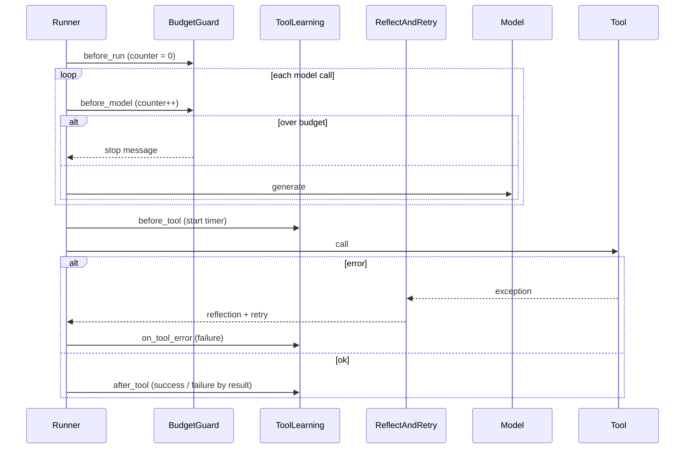

# LLD: Plugins & tools

## Plugins (`harness/plugins.py`)

Plugins apply to **every** agent, model call and tool call in the app.

| Plugin | Origin | Hooks | Behaviour |
|---|---|---|---|
| `ReflectAndRetryToolPlugin(max_retries=2)` | ADK | tool errors | Turns a failing tool call into a reflection prompt and retries |
| `ReflectAndRetryModelPlugin(max_retries=2)` | ADK | model errors | Retries malformed function calls |
| `ContextFilterPlugin(num_invocations_to_keep=20)` | ADK | before model | Hard cap on history reaching the model |
| `ToolLearningPlugin` | custom | before/after tool, on error | Times each tool call; records success or failure under source `tool:<name>` (a result `{"ok": false}` or `{"error": …}` counts as a failure) |
| `BudgetGuardPlugin` | custom | before run, before model, after run | Counts model calls per invocation; past `MAX_LLM_CALLS_PER_TURN` it returns a stop message instead of calling the model |
| `EpisodicMemoryPlugin` | custom | after run | `memory_service.add_session_to_memory(session)`, best-effort |
| `LoggingPlugin` | ADK, opt-in | all | `ADK_LOGGING=1` |
| `AutoTracingPlugin` | ADK, opt-in | all | `ENABLE_TRACING=1`, OpenTelemetry |
| `ToolCallIntegrityPlugin` | ADK, opt-in | tools | `TOOL_CALL_HMAC_KEY`, HMAC-stamped tool calls |

## Synthesizer tools (`harness/tools.py`)

| Tool | Purpose |
|---|---|
| `run_procedure(name, inputs_json)` | Compile and run one procedure with its dependencies |
| `find_procedures(query)` | Search the graph |
| `teach_procedure(...)` | Save a user-taught procedure (`origin=user`) |
| `remember_fact` / `recall_facts` / `forget_fact` | Semantic memory (+ `user:preferences`) |
| `define_term` / `lookup_term` | Glossary |
| `ingest_text` / `apply_ingest` | Stage and apply document ingestion (apply only after the user confirms) |
| `http_get_json(url, params_json)` | Allow-listed JSON GET; payloads over 4 KB go to artifacts |
| `load_web_page` | ADK built-in |
| `load_memory` | ADK built-in, episodic search |
| `SkillToolset(KGSkillRegistry)` | `search_skills`, `load_skill`, `load_skill_resource` over the graph |
| `web_search` or `GoogleSearchAgentTool` | Per `SEARCH_PROVIDER` |
| `McpToolset` × N | From `MCP_SERVERS` (streamable HTTP, prefixed tool names, 5-minute tool-list cache) |

Full signatures are in the [Tools reference](../reference/tools.md).
