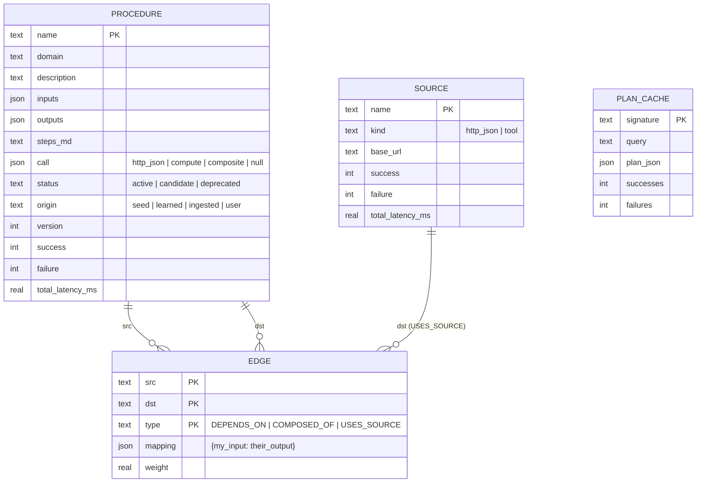
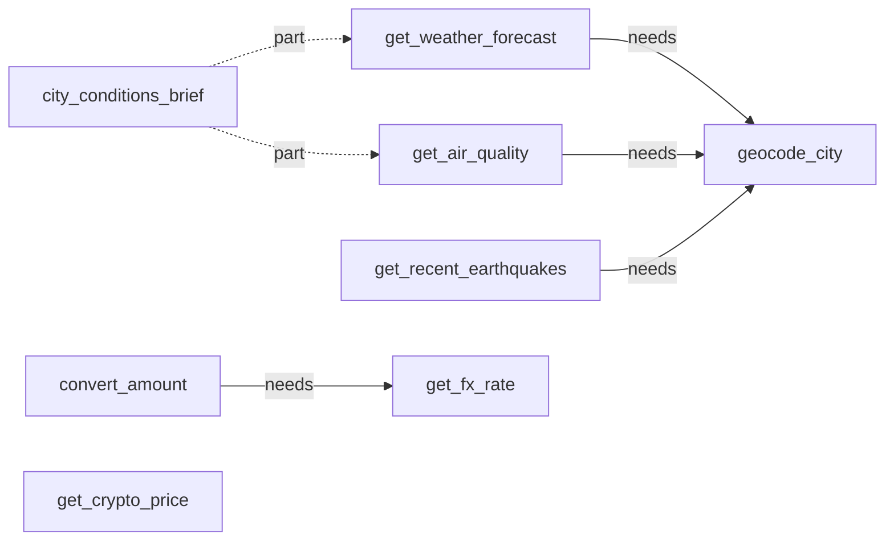
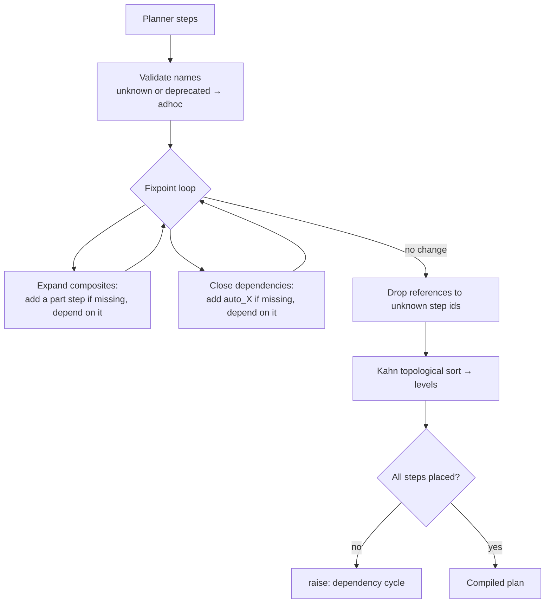

# LLD: Procedural knowledge graph

`memory/procedural_kg.py`: a property graph stored in SQLite.

## Data model



| Edge | Meaning | Example |
|---|---|---|
| `DEPENDS_ON` + mapping | Needs another procedure's outputs, wired input ← output | `get_weather_forecast → geocode_city {latitude: latitude, longitude: longitude}` |
| `COMPOSED_OF` | A composite (macro) procedure is made of parts | `city_conditions_brief → get_weather_forecast, get_air_quality` |
| `USES_SOURCE` | Which real-time source a procedure reads | `get_fx_rate → frankfurter` |

Cycles are rejected **when an edge is added** (`_creates_cycle` walks the dependency closure) and
again at compile time.

### The seed graph



## Search and ranking

`search(query, k)` is a two-stage hybrid:

1. **Candidates**: an FTS5 `MATCH` over name, domain, description, steps and I/O names, ordered by
   `bm25`. Without FTS5, every procedure is a candidate.
2. **Re-rank** each candidate:

    ```
    score = jaccard(query, name + description + domain + io)
          + 1 / (bm25_rank + 1)
          + 0.15 × reliability
          + 0.10 if learned and active
    ```

    Deprecated procedures are excluded. `reliability = (success + 1) / (success + failure + 2)`
    (Laplace-smoothed), so a new procedure starts at 0.5.

Before searching, `recall` expands the query with glossary meanings (`"smog"` adds
`AQI get air quality`), which is why vocabulary the user knows finds procedures named in the
code's vocabulary.

## The compile algorithm

`compile(plan) → {steps, levels, added, warnings}` turns the planner's intent into a safe,
complete, parallel execution plan.



Properties the compiler guarantees:

- **Completeness**: every executable step's transitive dependencies are present, so the planner
  never has to remember geocoding.
- **Deduplication**: one step per procedure. Two steps needing `geocode_city` share one
  `auto_geocode_city` (see [Example 4](../examples/composite.md)).
- **Maximal parallelism**: each level holds every step whose dependencies are all in earlier levels.
- **Composite reuse**: a learned macro expands into its parts and their dependencies, and becomes
  a final step that merges their outputs.

A real compile, from [Example 4](../examples/composite.md):

| Level | Steps |
|---|---|
| 0 | `auto_geocode_city` |
| 1 | `s1_get_air_quality`, `s1_get_weather_forecast` (in parallel) |
| 2 | `s1` (`city_conditions_brief` merges both) |

## Plan cache

`cache_plan(query, plan, ok)` stores the planner's plan under an order-insensitive token
signature. `cached_plan(query)` returns the best entry with `successes > failures` and Jaccard
similarity of at least 0.8. `recall` hands it to the planner, which reuses the structure with new
input values (see [Example 8](../examples/learning.md)).

## Exposure as ADK Skills

`KGSkillRegistry` implements ADK's `SkillRegistry`, so the graph appears to the synthesizer as
**Agent Skills** with progressive disclosure:

| Level | ADK tool | What the model gets |
|---|---|---|
| L1 | `search_skills` | name (kebab-case), description, domain, reliability, status |
| L2 | `load_skill` | steps, inputs/outputs, dependencies, parts, version, origin |
| L3 | `load_skill_resource` | `call_spec.json`, `lessons.md` (relevant Reflexion lessons) |

Learned and ingested procedures appear as skills immediately, with no redeploy.
