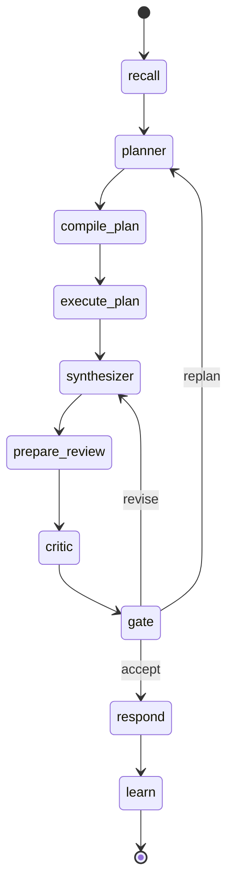
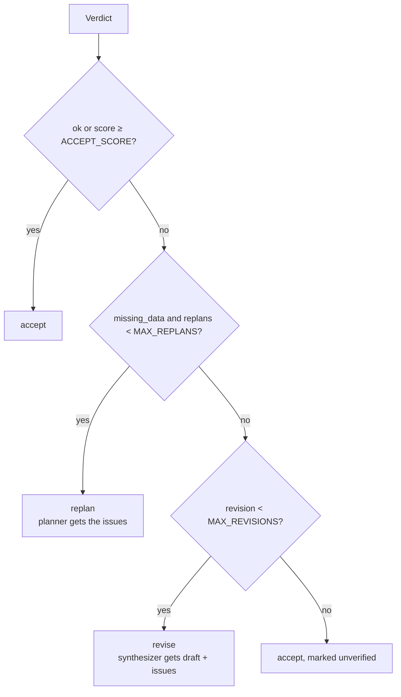

# LLD: Workflow & nodes

`root_agent` is an ADK 2.x **graph `Workflow`** (`agent.build_workflow`). Its nodes are either
**LLM agents** (`google.adk.Agent`) or **function nodes** (plain Python functions that take
`(ctx: Context, node_input)`). Each node's return value becomes the next node's `node_input`; a node
picks a branch by setting `ctx.route`.



```python title="procedural_agent/agent.py"
Workflow(
    name="procedural_agent",
    edges=[
        ("START", nodes.recall, planner, nodes.compile_plan, nodes.execute_plan,
         synthesizer, nodes.prepare_review, critic, nodes.gate),
        (nodes.gate, {"accept": nodes.respond, "revise": synthesizer, "replan": planner}),
        (nodes.respond, nodes.learn),
    ],
)
```

## Node contracts

| Node | Kind | `node_input` | Returns | Side effects |
|---|---|---|---|---|
| `recall` | function | user text | planner prompt (str) | Resets per-turn counters; reads every store; sets `temp:brief`, `temp:playbook`, `temp:playbook_ids`, `temp:lessons`; increments `turns` |
| `planner` | LLM, `output_schema=Plan` | planner prompt | `Plan` dict | `plan` (output_key) |
| `compile_plan` | function | `Plan` dict | compiled plan | Normalises inputs with the glossary; `temp:plan`, `temp:compiled`; a rejected plan becomes an empty plan with a warning |
| `execute_plan` | function (async) | compiled plan | synthesizer prompt | Runs the DAG; records procedure and source stats; `temp:results`; saves artifact `plan_results.json` |
| `synthesizer` | LLM + tools | synthesizer prompt | draft text | `draft`; tool side effects |
| `prepare_review` | function | draft | critic prompt | `temp:draft` |
| `critic` | LLM, `output_schema=Verdict` | critic prompt | `Verdict` dict | `verdict` |
| `gate` | function | `Verdict` | text for the next node | Sets `ctx.route`; appends to `temp:verdicts`; increments `temp:revision` / `temp:replans` |
| `respond` | function | draft | `types.Content` (shown to the user) | Adds an "unverified" note if the loops ran out |
| `learn` | function (async) | — | `None` | See [LLD: Learning](lld-learning.md); sets `last_learning` |

## Routing policy (`gate`)



The loops are bounded twice over: by these counters, and by `BudgetGuardPlugin` (at most
`MAX_LLM_CALLS_PER_TURN` model calls per turn).

## Why agents only see their `node_input`

In a workflow, an LLM agent receives the previous node's output as its user content, not the whole
conversation. So the function nodes **build each prompt explicitly** from state: `_planner_prompt`
and `_synth_prompt`. On a revise, the synthesizer gets the original question, the step results,
its previous draft and the critic's issues. Each call is therefore self-contained and cheap, and
the static instruction prefix stays cacheable (see [Prompt caching](../capabilities/prompt-caching.md)).

## Prompts and instruction providers

Each LLM agent has:

- `static_instruction`: the fixed part of `prompts/<role>.md` (everything before `<!-- dynamic -->`)
- `instruction`: a provider function that renders the dynamic part every call (learned playbook
  bullets, relevant lessons, user preferences)

`prompts/__init__.py` versions prompts: optimised versions live in
`$AGENT_DATA_DIR/prompts/<role>/vN.md` with an `active.json` pointer and `rollback()`.

## App-level configuration

```python title="procedural_agent/agent.py (build_app)"
App(
    name="procedural_agent",
    root_agent=workflow,
    plugins=build_plugins(),
    events_compaction_config=EventsCompactionConfig(summarizer=LlmEventSummarizer(...), ...),
    context_cache_config=ContextCacheConfig(...),   # only when AGENT_MODEL is Gemini
    resumability_config=ResumabilityConfig(is_resumable=True),
)
```
