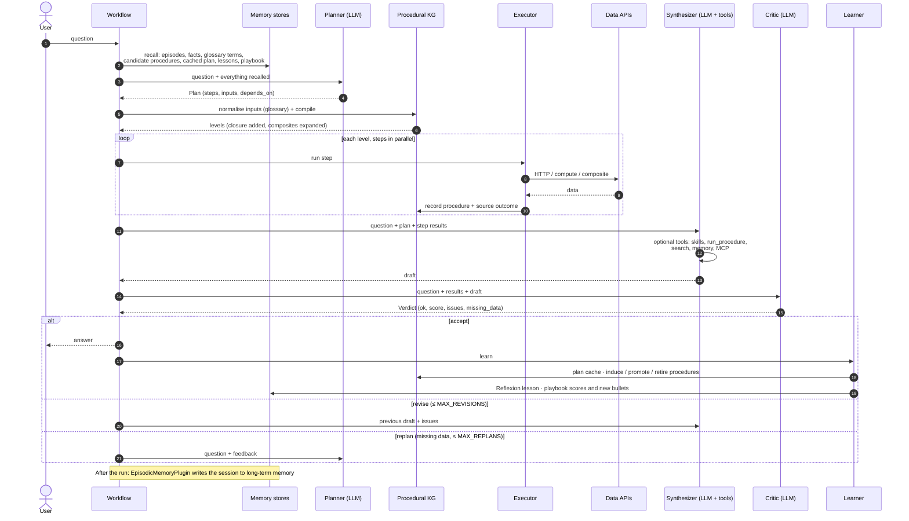

# Request lifecycle

One question, end to end. The path is the same every time; only the loops (revise or re-plan) and
the learning outcomes vary.

## What each stage adds

| # | Stage | Adds to state | Typical cost |
|---|---|---|---|
| 1 | `recall` | `temp:brief`, `temp:playbook`, `temp:lessons`, `temp:query` | Milliseconds (SQLite + memory search) |
| 2 | `planner` | `plan` | 1 LLM call (structured output) |
| 3 | `compile_plan` | `temp:compiled` (levels, added steps, normalisations) | Milliseconds |
| 4 | `execute_plan` | `temp:results`, artifact `plan_results.json` | Slowest level × number of levels |
| 5 | `synthesizer` | `draft` | 1+ LLM calls (more if it uses tools) |
| 6 | `critic` | `verdict`, `temp:verdicts` | 1 LLM call |
| 7 | `gate` | route `accept` / `revise` / `replan` | — |
| 8 | `respond` | final message | — |
| 9 | `learn` | `last_learning` | 0–3 LLM calls (only when something is learned) |

See it with real values in the [worked examples](../examples/index.md). The
[Example 6 node path](../examples/replan.md) shows a full re-plan loop.
