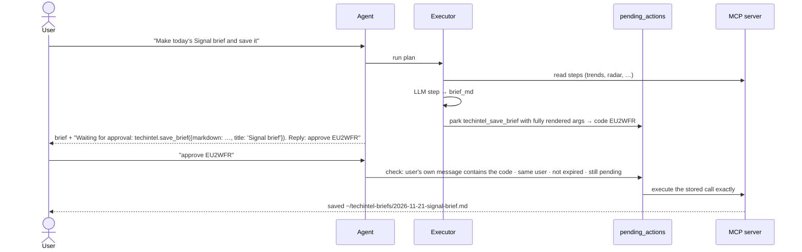

# Actions & approvals

**What it does.** Lets procedures **change things**, such as saving files, creating tickets or
sending messages, while guaranteeing that **nothing with a side effect runs without an explicit
human yes**, and that what runs is exactly what was previewed.

## Side-effect levels

| `Side effect:` | Examples | Behaviour |
|---|---|---|
| `read` *(default)* | search, list, get | Runs during planning; can be learned into composites |
| `write` | create a ticket, save a file, add a comment | **Parked**: preview + approval code; runs only after approval |
| `destructive` | delete, send an email, transition to Done | Same as write, flagged louder in the preview |

Write and destructive steps are **never learned** into automatic composites; each one always
needs its own approval.

## The flow

## The guarantees

| Guarantee | How |
|---|---|
| Nothing writes during planning | The executor parks every write or destructive step before calling it |
| What runs is what you saw | The **fully rendered** call (tool + final arguments) is stored, then replayed without re-templating |
| The model can't approve for you | `approve_action` checks that the **user's latest message** contains the code |
| Only the requester can approve | The code is bound to the `user_id` |
| One yes, one execution | Status moves to `executed`, `failed`, `rejected` or `expired`; re-use is refused |
| Stale approvals expire | `APPROVAL_TTL_HOURS` (default 24) |
| Dependents wait | Steps that need a parked step are `skipped` with "Waiting for approval" |

## Approving

| Where | How |
|---|---|
| Chat (`adk web`, any UI) | Reply `approve EU2WFR` or `reject EU2WFR` |
| `run_cli.py` | `/pending`, `/approve EU2WFR`, `/reject EU2WFR` |
| Scripts / cron | `python scripts/approve.py --list`, `python scripts/approve.py EU2WFR --user srini` |

All of this is covered offline by `tests/test_mcp_procedures.py`, using a real local stdio MCP
server.

## Standing approvals (unattended runs)

A scheduled run has nobody to type a code. The operator can pre-approve one write procedure with
fixed argument values in `approvals_policy.json` (path: `APPROVALS_POLICY_FILE`). Matching steps
run immediately and are logged as `executed` with `approved_by: "standing approval #N"`; anything
outside the rule's bounds is parked as usual, and `destructive` steps never match. Rules need an
`until` date. See [Scheduling & notifications](../operations/scheduling.md).
