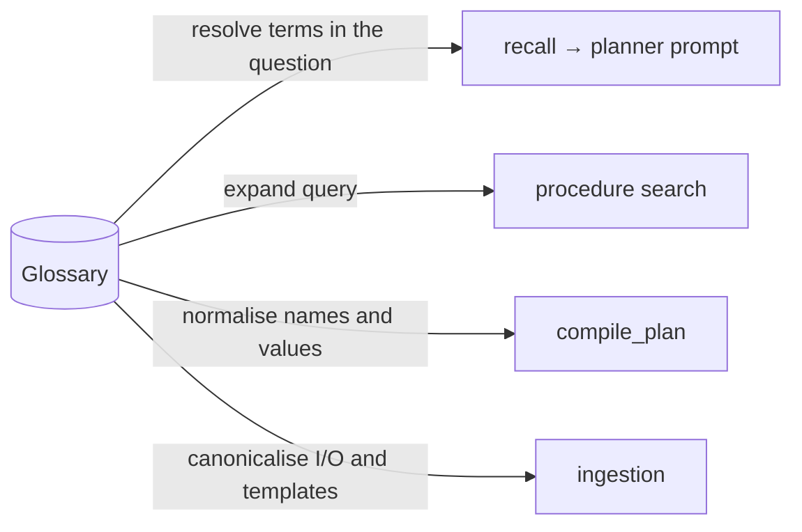

# Glossary

**What it does.** Bridges the words people use and the names procedures use: "rupees" → `INR`,
"lng" → `longitude`, "smog" → the `AQI` concept and the `get_air_quality` procedure.

## Three kinds of entry

| Kind | Holds | Example |
|---|---|---|
| `parameter` | canonical input/output names, aliases, unit, value format | `longitude` ← `lon`, `lng`; `vs_currency` is lower-case |
| `value` | canonical values, scoped to the parameters they apply to | `INR` ← "rupees", "₹", "rs" for `from_currency`, `to_currency`, `vs_currency` |
| `concept` | domain terms, definitions, linked procedures | `AQI` ← "air quality", "smog"; "0–50 good, 51–100 moderate…" → `get_air_quality` |

## Where it's used



| Use | Behaviour |
|---|---|
| **Planner prompt** | Value and concept terms found in the question (longest match, up to 4 words) are listed with their meanings |
| **Search** | The query gets canonical names plus linked procedure names appended |
| **Plan normalisation** | Input names → canonical names (unless the procedure itself declares that name); values → canonical values in scope; then the parameter's format is applied |
| **Ingestion** | Document names such as `lat_deg` become `latitude`, inside templates too, so dependencies can be matched |

Parameter aliases such as "to", "from" and "value" are **not** matched in prose, so ordinary words
don't cause false hits.

## Adding terms

=== "Seed JSON"

    ```json title="procedural_agent/seed/glossary.json"
    {"values": [{"canonical": "INR", "scope": ["from_currency", "to_currency", "vs_currency"],
                 "aliases": ["rupee", "rupees", "₹", "rs"]}]}
    ```

=== "Bulk load"

    ```bash
    python scripts/ingest.py my_glossary.json --glossary
    ```

=== "Term cards in a document"

    ```markdown
    ## Term: MRR
    Kind: concept
    Aliases: monthly recurring revenue
    Definition: Sum of active subscriptions' monthly price, excluding one-off fees.
    Related: get_mrr
    ```

=== "In chat"

    > *By MRR we mean monthly recurring revenue, excluding one-off fees.*

    The synthesizer calls `define_term(...)`.

## Real example: normalisation

--8<-- "ex_dependent.md"
