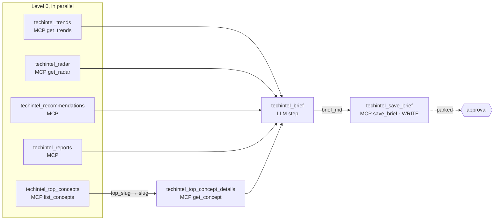

# MCP & LLM steps in procedures

**What it does.** Any tool on any MCP server, local or remote, can be a **procedure step**, and
a procedure can include an **LLM step** that summarises, classifies or drafts text. These steps
take part in everything the graph offers: dependencies, parallel levels, reliability stats,
learning and approvals. The engine is generic; everything app-specific lives in config and cards.



## 1. Configure MCP servers

```json title="mcp_servers.json (repo root, git-ignored)"
{
  "servers": [
    {"name": "techintel", "command": "python", "args": ["packs/techintel/techintel_mcp.py"],
     "env": {"TECHINTEL_URL": "${TECHINTEL_URL}", "TECHINTEL_EMAIL": "${TECHINTEL_EMAIL}",
             "TECHINTEL_PASSWORD": "${TECHINTEL_PASSWORD}"}},
    {"name": "time", "command": "uvx", "args": ["mcp-server-time"]},
    {"name": "atlassian", "url": "https://mcp.atlassian.com/v2/mcp",
     "headers": {"Authorization": "Bearer ${ATLASSIAN_TOKEN}"}}
  ]
}
```

| Entry | Transport |
|---|---|
| `"command"` + `"args"` (+ `env`, `cwd`, `timeout`) | Local server over **stdio**, started on first use and kept for reuse |
| `"url"` (+ `headers`, `timeout`) | Remote server over **streamable HTTP** |

`${VAR}` is expanded from the environment, so secrets stay in `.env`. The file location can be
changed with `MCP_SERVERS_FILE`; entries can also be passed in `MCP_SERVERS` (JSON).

The same servers serve two consumers: **procedure steps** (deterministic, measured) and the
synthesizer's **McpToolsets**, with tool names prefixed by the server name, for ad-hoc use.

## 2. Write cards

```markdown
## Procedure: techintel_top_concept_details
Description: Technical deep-dive on the top trending concept right now.
Inputs: slug
Outputs: concept
Needs: techintel_top_concepts (slug->top_slug)
MCP: techintel.get_concept slug={slug}
Extract: concept = .
Required: concept

## Procedure: techintel_brief
Outputs: brief_md
Needs: techintel_trends; techintel_radar; techintel_recommendations; techintel_top_concept_details; techintel_reports
LLM: Using ONLY the data below, write a Markdown brief ... DATA: rising={rising} radar={rings} top_concept={concept} ...
```

| Field | Meaning |
|---|---|
| `MCP: server.tool k=v k2="two words"` | The tool to call; values may use `{input}`; numbers are converted to numbers |
| `Extract: out = path` | Optional; same path language as HTTP steps (`.` = the whole result). Without it, a dict result becomes the outputs and anything else becomes `{"result": …}` |
| `LLM: <prompt>` | A text step: `{var}` takes inputs **and dependency outputs**; dicts and lists are inlined as compact JSON; `{upstream}` is every dependency output. Runs on `LLM_STEP_MODEL` |
| `Side effect: write \| destructive` | Never runs during planning; see [Actions & approvals](actions-approvals.md) |

## 3. Ingest and run

```bash
python scripts/ingest.py packs/techintel/procedures.md          # read steps are test-called live
python scripts/ingest.py --apply-batch <id>
python scripts/run_procedure.py techintel_brief --user srini     # or just ask in chat
```

During ingestion:

- `MCP:` read steps with no unresolved placeholders are **called once against the live server**
  (`verified`).
- An unknown server is **blocked**.
- Write steps are never test-called.
- LLM steps are checked for placeholders that no input or dependency provides.

## Behaviour in the graph

| Aspect | MCP step | LLM step |
|---|---|---|
| Parallelism | Same level → concurrent calls on a pooled session | Runs when its inputs are ready |
| Reliability | `record_outcome(procedure)` + source `mcp:<server>` | `record_outcome(procedure)` |
| Learning | Can be part of induced composites (read-only steps only) | Same |
| Timeouts | `STEP_TIMEOUT_S × 3` | Model provider's timeout |

See the real run in [Example 11](../examples/signal.md).
