# Parallel execution

**What it does.** Runs every step whose inputs are ready **at the same time**, so a question
needing five sources costs about the time of its slowest chain, not the sum of all five.

## How it works

The compiler sorts steps into **topological levels** with Kahn's algorithm. The executor runs one
level at a time, each level through `asyncio.gather`, bounded by `MAX_PARALLEL_STEPS`. Outputs
flow to the next level along `DEPENDS_ON` edges.

```mermaid
gantt
  dateFormat X
  axisFormat %L ms
  title Example 8, turn 1: three needs, one shared dependency
  section Level 0
  auto_geocode_city :0, 180
  auto_get_fx_rate  :0, 120
  section Level 1
  s1 get_weather_forecast :180, 390
  s2 get_air_quality      :180, 350
  s3 convert_amount       :180, 181
```

*Illustrative latencies; the real per-step latencies are recorded in each step result.*

## What makes steps parallel

| Situation | Result |
|---|---|
| Two steps with no dependency path between them | Same level |
| Two steps needing the same dependency | One shared dependency step in an earlier level, then both together |
| A dependency failed | Dependents are **skipped**; other branches still run ([Example 7](../examples/failure.md)) |
| A composite | Its parts in parallel, then the composite merges their outputs |

## Configuration

| Setting | Default | Effect |
|---|---|---|
| `MAX_PARALLEL_STEPS` | 8 | Concurrency cap per level |
| `STEP_TIMEOUT_S` | 20 | Per-request timeout (3× for the whole step) |

## Real example: two independent needs

--8<-- "ex_parallel.md"

Note `learn`'s output: because both branches worked and the answer passed review, the agent
**induced a new procedure** for "air quality and crypto price". See [Self-learning](self-learning.md).
