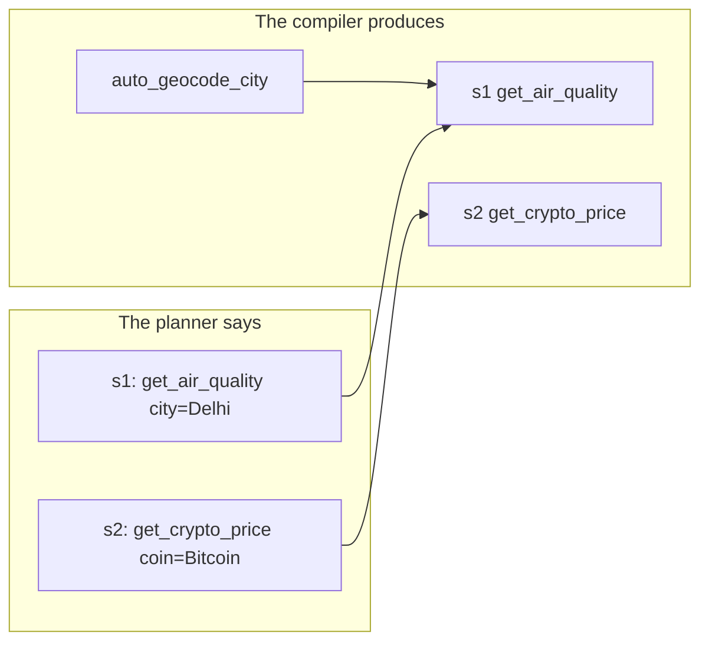

# Planning & dependencies

**What it does.** Turns a question into the smallest correct set of procedures, whether one,
several independent ones, or a dependent chain, and makes sure everything they need runs first.

## How it works

1. `recall` gathers **candidate procedures** (search expanded with the glossary), a **cached plan**
   for similar questions, relevant facts, past episodes, the playbook and lessons.
2. The **planner** (an LLM with structured `Plan` output) picks procedures and fills in inputs.
   It only has to state *needs*. The rules in its prompt include:
    - use only catalogue names; use `adhoc` when nothing fits
    - give independent needs separate steps with no `depends_on`
    - the compiler adds a procedure's own dependencies, so it doesn't need to list them
3. `compile_plan` normalises inputs with the glossary, then the **compiler** expands composites,
   closes dependencies, deduplicates shared steps and sorts everything into levels.



## The plan format

```json
{
  "intent": "air quality and crypto price",
  "domain": "mixed",
  "steps": [
    {"id": "s1", "procedure": "get_air_quality", "inputs": [{"name": "city", "value": "Delhi"}]},
    {"id": "s2", "procedure": "get_crypto_price",
     "inputs": [{"name": "coin", "value": "bitcoin"}, {"name": "vs_currency", "value": "inr"}]}
  ],
  "answer_strategy": "AQI band first, then price"
}
```

Inputs are a list of `{name, value}` rather than a map, because some providers' structured-output
modes reject free-form maps.

## Question shapes it handles

| Shape | Example question | Plan → compiled | Example |
|---|---|---|---|
| Single procedure with a hidden dependency | *Weather in Hyderabad?* | 1 step → 2 levels (`geocode_city` added) | [1](../examples/single.md) |
| Dependent chain | *250 euros in rupees?* | `convert_amount` → `get_fx_rate` added first | [2](../examples/dependent.md) |
| Independent needs | *AQI in Delhi and bitcoin in INR?* | 2 steps, parallel where possible | [3](../examples/parallel.md) |
| Composite | *Good day for a run in Bangalore?* | 1 composite → 3 levels | [4](../examples/composite.md) |
| Missing data found by the critic | *Weather in Kathmandu and is the air safe?* | Re-plan adds the missing step | [6](../examples/replan.md) |
| Nothing fits | *Water level of Hussain Sagar?* | `adhoc` step → the synthesizer uses search or tools | — |

## Configuration

| Setting | Effect |
|---|---|
| `PLANNER_MODEL`, `PLANNER_REASONING` | Model and reasoning effort for planning |
| `MAX_REPLANS` | How often the critic can send the plan back |
| `seed/procedures.json`, ingestion, `teach_procedure` | What the planner can choose from |

## Real example

--8<-- "ex_single.md"
