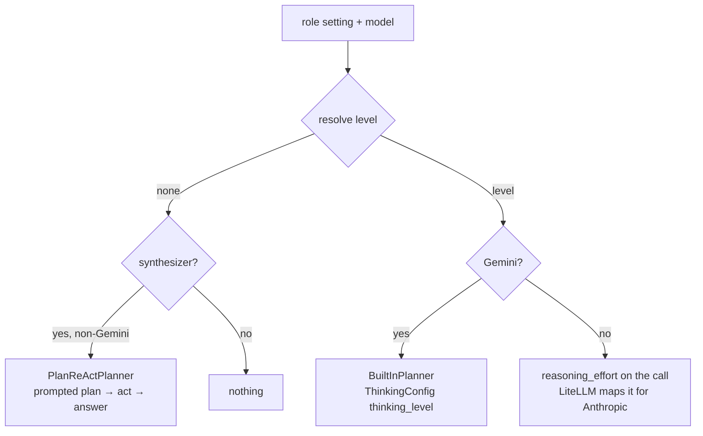

# Reasoning

**What it does.** Lets each role think before it answers, on every provider, with a sensible
fallback for models that can't reason.

## Settings

`PLANNER_REASONING`, `AGENT_REASONING`, `CRITIC_REASONING` = `off | auto | minimal | low | medium | high`

| Value | Behaviour |
|---|---|
| `off` | No reasoning parameters |
| `auto` | `medium` when the model is known to reason, otherwise off |
| a level | Forced. Use this for Azure or TrueFoundry deployment names that hide the model |

"Known to reason" means LiteLLM's model map says so (TrueFoundry's account prefix is stripped
first), or the name matches a reasoning family such as `gpt-5`, `o1`/`o3`/`o4`, Claude 4,
DeepSeek-R1, QwQ, or Gemini 2.5 and later.

## How each provider gets it



| Provider | Mechanism |
|---|---|
| Gemini | ADK `BuiltInPlanner(thinking_config=ThinkingConfig(thinking_level=…))` |
| OpenAI, Azure OpenAI (o-series, GPT-5) | `reasoning_effort` |
| TrueFoundry | `reasoning_effort`, forwarded by the gateway to the model behind it |
| Anthropic / Bedrock Claude | `reasoning_effort`, which LiteLLM turns into an extended-thinking budget |
| Any model without reasoning (synthesizer only) | `PlanReActPlanner`: the model writes `/*PLANNING*/ … /*FINAL_ANSWER*/` and only the final answer is kept |

The planner and critic use structured output, so they never get `PlanReActPlanner`; its tags would
break the JSON. The offline test `test_plan_react_keeps_only_the_final_answer` checks that the
plan text never reaches `draft`.

## Example

```bash
PLANNER_MODEL=truefoundry/openai-main/gpt-5      # auto → medium
AGENT_MODEL=azure/gpt-4o-prod                    # auto → none → PlanReActPlanner
CRITIC_MODEL=anthropic/claude-sonnet-4-5
CRITIC_REASONING=low                             # → reasoning_effort=low → thinking budget
```

The resolved values are shown in [Example 10](../examples/providers.md).
