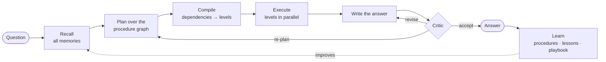

---
hide:
  - navigation
---

# ADK Procedural Agent

A self-learning agent for **real-time data questions**, built on **Google ADK 2.x**. It keeps its
know-how as a **procedural memory knowledge graph**: procedures, the dependencies between them, and
the data sources they read. It plans over that graph, fetches what it needs in parallel, checks its
own answer, and **gets better with every run**.

## What it does

- :material-graph-outline: **Plans over a procedure graph**

    A question can need one procedure or many. Dependencies are added automatically, and
    independent needs run in parallel.
    [Planning →](capabilities/planning.md)

- :material-brain: **Eleven kinds of memory**

    Working, summarised, episodic, semantic, procedural, glossary, plan cache, reflective lessons,
    playbook, artifacts and source reliability.
    [Memory →](capabilities/memory.md)

- :material-school: **Learns as it works**

    A successful multi-step run becomes a new procedure. It's promoted after repeated success and
    retired if it starts failing.
    [Self-learning →](capabilities/self-learning.md)

- :material-check-decagram: **Checks itself**

    A critic verifies every answer against the fetched data, then asks for a rewrite or a re-plan.
    [Self-correction →](capabilities/self-correction.md)

- :material-file-document-arrow-right: **Reads your SOPs**

    Free-text runbooks and procedure cards become reviewed graph nodes and edges.
    [Ingestion →](capabilities/ingestion.md)

- :material-swap-horizontal: **Any LLM**

    Gemini, OpenAI, Azure OpenAI, TrueFoundry, Anthropic, Bedrock or Ollama, set per role, with
    fallback chains.
    [Models →](capabilities/multi-llm.md)

## Start here

| If you want to… | Read |
|---|---|
| Run it in five minutes | [Quickstart](getting-started/quickstart.md) |
| Understand the design | [High-level design](architecture/hld.md) → [Request lifecycle](architecture/request-lifecycle.md) |
| See it work, step by step | [Worked examples](examples/index.md), generated from real runs of the code |
| Add your own procedures | [Procedure cards](reference/procedure-cards.md) and [Ingestion](capabilities/ingestion.md) |
| Run it on Azure / OpenAI / TrueFoundry | [Multiple LLM providers](capabilities/multi-llm.md) |
| Deploy it | [Deployment](operations/deployment.md) |

## At a glance

| | |
|---|---|
| **Framework** | Google ADK 2.15 (graph `Workflow`, `App`, plugins, Skills, memory services) |
| **Language** | Python 3.11+ |
| **Storage** | SQLite with FTS5 (local) · Agent Engine sessions + Memory Bank + GCS (production) |
| **Models** | Native Gemini, plus everything LiteLLM supports |
| **Tests** | 31 offline tests (scripted models, LiteLLM mocks, mock APIs) |
| **Repository** | [github.com/yashodhantek/adk-procedural-agent](https://github.com/yashodhantek/adk-procedural-agent) |
