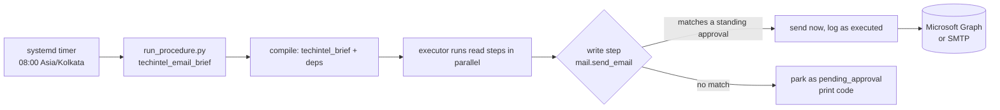

# Scheduling & notifications

Run a procedure on a timetable and deliver its result by email, with no one at the keyboard.
The worked case is the **daily Signal brief**: every morning at 08:00 IST the agent pulls the
latest from Signal (techintel), writes the brief, and emails it to you.



## Pieces

| Piece | File | Role |
|---|---|---|
| Mail MCP server | `packs/mail/mail_mcp.py` | Tool `send_email(to, subject, markdown, cc="")`. Markdown becomes HTML. Providers: `graph`, `smtp`, `auto` (Graph if `MS_*` set, else SMTP). `MAIL_DRY_RUN=1` writes the email to `MAIL_OUTBOX_DIR` instead. |
| Procedure card | `packs/techintel/procedures.md` → `techintel_email_brief` | Needs `techintel_brief`, then calls `mail.send_email`; `Side effect: write`. |
| Standing approvals | `approvals_policy.json` (operator file, not in git) | Lets one write procedure run unattended within exact bounds. |
| Runner | `scripts/run_procedure.py` | Compiles and runs one procedure; `--dry-run` ignores standing approvals. |
| Timer | `deploy/systemd/signal-brief.{service,timer}`, `deploy/cron.example` | Fires the runner daily. |

## Standing approvals

A write step normally waits for you to type its approval code. A scheduled run has nobody to
type it, so the operator can pre-approve **one procedure with fixed arguments** in
`approvals_policy.json`:

```json
[
  {
    "procedure": "techintel_email_brief",
    "args": {"to": ["srini@yashodhantek.com"]},
    "users": ["srini"],
    "until": "2027-05-21",
    "note": "daily Signal brief to myself"
  }
]
```

A rule matches only when **all** of these hold:

- the step is `write`; `destructive` steps are never auto-approved;
- the procedure name is exactly the one in the rule;
- `until` is a valid date not yet passed (a rule without it is ignored);
- the run's user is in `users`, if given;
- every key in `args` is present in the rendered call, and every value in it
  (comma or semicolon separated, case-insensitive) is in the allowlist. One extra recipient → no match.

When a rule matches, the step runs at once and is still written to `pending_actions` with status
`executed`, the exact arguments, and `approved_by: "standing approval #N (note)"`, so
`scripts/approve.py --list` and the audit trail show every unattended send. Anything that doesn't
match is parked exactly as before. The file lives with the operator, not in the graph, so a
procedure card or an ingested document cannot grant itself permission.

## Set it up

1. **Mail credentials** in `.env`. Microsoft Graph uses an Entra app with the *Mail.Send*
   application permission (the same app Signal uses):

    ```bash
    MAIL_PROVIDER=auto
    MAIL_FROM=intel@yashodhantek.com
    MS_TENANT_ID=…
    MS_CLIENT_ID=…
    MS_CLIENT_SECRET=…
    # or SMTP: SMTP_HOST, SMTP_PORT=587, SMTP_USER, SMTP_PASSWORD
    ```

2. **Servers and policy**:

    ```bash
    cp packs/techintel/mcp_servers.json.example mcp_servers.json
    cp packs/techintel/approvals_policy.json.example approvals_policy.json
    python scripts/ingest.py packs/techintel/procedures.md --apply
    ```

3. **Try it without sending**:

    ```bash
    MAIL_DRY_RUN=1 python scripts/run_procedure.py techintel_email_brief \
        to=srini@yashodhantek.com --user srini
    ls .data/outbox/      # the rendered HTML email and its JSON envelope
    python scripts/run_procedure.py techintel_email_brief \
        to=srini@yashodhantek.com --user srini --dry-run   # parks instead of sending
    ```

4. **Send one for real**, then **install the timer**:

    ```bash
    python scripts/run_procedure.py techintel_email_brief to=srini@yashodhantek.com --user srini
    sudo cp deploy/systemd/signal-brief.* /etc/systemd/system/
    sudo systemctl daemon-reload && sudo systemctl enable --now signal-brief.timer
    systemctl list-timers signal-brief.timer
    journalctl -u signal-brief.service -n 50
    ```

    Edit `WorkingDirectory` and `ExecStart` in the service file if the repo isn't at
    `/root/adk-procedural-agent`. Without systemd, use `deploy/cron.example`
    (`30 2 * * *` UTC = 08:00 IST).

## Other procedures

Any write procedure can be scheduled the same way: add a card with `Side effect: write`, add a
rule naming that procedure and the argument values it may use, and point a timer at
`run_procedure.py`. Keep `until` short and renew it deliberately.
